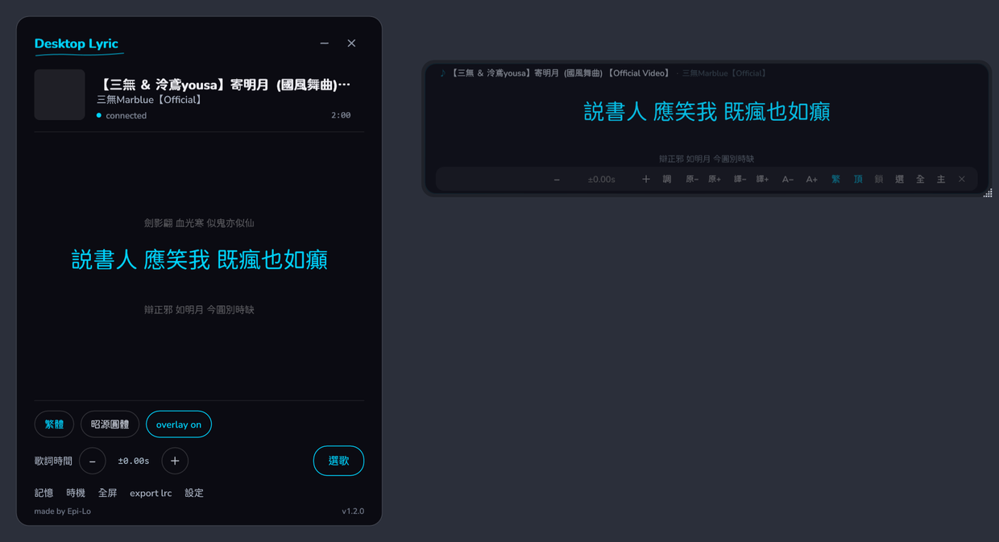

#  desktop-lyric

Desktop lyrics overlay for Windows. Shows synced lyrics with Chinese translation for whatever's playing in Spotify, Tidal, YouTube in the browser, or any player that shows up in Windows media controls (SMTC).

**[Download for Windows 10 / 11](https://github.com/Epi-Lo/desktop-lyric/releases/latest)** · [1 min video (繁中)](https://www.youtube.com/watch?v=QKDJHOTYgkw) · free, MIT



聽 Spotify、Tidal，或用瀏覽器開 YouTube 聽歌的時候，歌詞會直接浮在畫面最上面，英文歌、日文歌下面自動翻成中文。打遊戲、看小說、做簡報都看得到，不用再切出去。日文歌可以開羅馬拼音，有逐字資料的歌會一個字一個字亮。預設繁體中文（香港用字），按「繁」可以切回原文。解壓縮就能用，不用安裝。

## What it does

### Lyrics

- Finds the song playing through Windows SMTC, no plugin for the player needed
- Searches Netease, QQ Music, Kugou and LRCLIB at the same time and keeps the one closest to the song length
- Chinese translation under each line, Traditional Chinese by default (OpenCC + Hong Kong variants)
- Romaji for Japanese songs, word-by-word karaoke when Netease has YRC data for the song
- Stays in sync when the player's position freezes for a few seconds

### Overlay

- Floats on top, drag it anywhere. Clicks go through it when the mouse is not on the lyrics, so it doesn't block games
- Transparency from 40 to 100% in 設定, turn it down abit when gaming
- 鎖 locks the current lyrics, so YouTube hover previews or mix titles don't swap the song
- Fullscreen mode (F11)

### When it gets the song or the timing wrong

- 選 opens the song picker. Lock the title or the artist and search again, it remembers your pick next time
- Cleans up YouTube titles, e.g. takes the song name out of 「」 or `artist【song】` and drops "- Topic"
- Timing editor for live versions: offset, speed, per line shift, LRC import / export

### Looks

Two looks, pick in 設定 > 外觀: 經典 (the dark one) or 萃香. The overlay follows the same pick.


## Install

Download `DesktopLyric-1.3.0-win-x64.zip` from [Releases](https://github.com/Epi-Lo/desktop-lyric/releases), unzip, and keep `DesktopLyric.exe` next to the `Fonts` folder. No install needed.

Or build from source:

```
dotnet publish src/DesktopLyric/DesktopLyric.csproj -c Release
```

The font files are not in the repo (too big), copy the two `ChironGoRoundTC-*.ttf` from the release zip into `src/DesktopLyric/Fonts/` first. Without them it still runs, just with a normal system font. If your SDK is .NET 10, set `DOTNET_ROLL_FORWARD=LatestMajor`.

## Usage

1. Play music in Spotify, Tidal, YouTube, or anything that shows in Windows media controls
2. Run `DesktopLyric.exe`, the overlay shows up by itself
3. Wrong song? Click 選 on the overlay and pick the right one, then 鎖 if you want it to stay
4. Live version timing off? Open the timing editor and shift it
5. Closing the main window only hides it. To quit, use ✕ on the overlay (when the main window is hidden) or 結束 in the tray icon

## Known limits

- Translation quality depends on Google Translate
- Karaoke timing only works when Netease has YRC data for the song
- YouTube mixes often show the channel name as the title, need to pick the song by hand or lock it
- Windows only

## Settings and files

Saved in `%AppData%\DesktopLyric\`:

- `settings.json` - settings, you can edit it by hand or in the app
- `choices.json` - songs you picked with 選
- `offsets.json` - per song timing from the timing editor
- `run.log` - for checking crashes

## About the 萃香 look

It's a Touhou Project fan theme (伊吹萃香), not official. Both pictures, `Assets/suika.png` (main window) and `Assets/suika-overlay.png` (overlay background), are made by me with AI. Not someone else's fan art, so ok to ship with the app.

## About the commit history

I wrote this on my own pc from Jan to May 2026 and only pushed it to GitHub on 14 May, so every old commit shows the same "verified" time. The commit dates are the real local ones.

Some old commit messages have `鈥?` in them, that was an em dash broken by PowerShell. Can't fix without rewriting history, so I just leave it.

---

made by [Epi-Lo](https://github.com/Epi-Lo) · most of the 1.1.0 stuff (sync fix, OpenCC, timing editor) is from [pxxpkm](https://github.com/pxxpkm), thanks a lot · issues and PRs welcome
